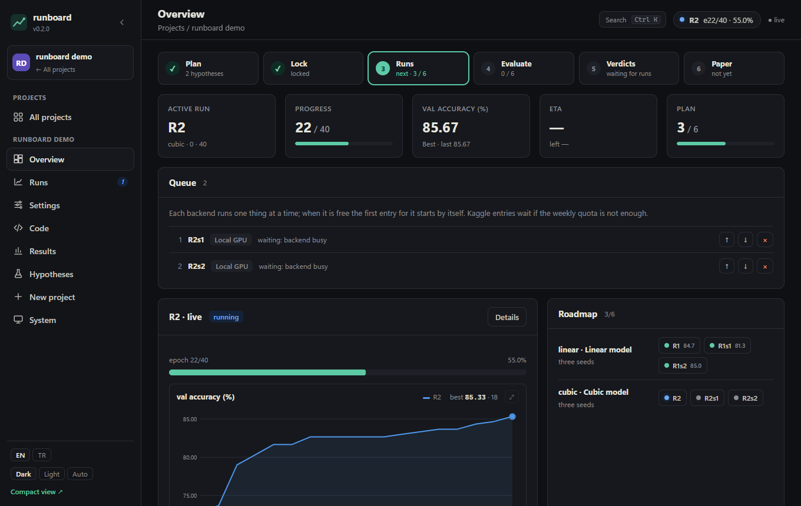

# runboard

**A dashboard for your training runs: start them anywhere, watch them live, keep them in order.**

runboard runs on your own computer and manages the training runs of your projects. Start a run on this computer's
GPU, on Kaggle's free GPUs, on a rented machine over SSH or on a SLURM cluster, from one page. Follow every run
second by second (log, epoch, metrics, time left), queue the next ones, compare them, edit the plan and the code, and
see the results side by side.

Everything is a readable file in your project folder and goes into git: no account, no server, no hidden database.

[](https://github.com/alperentoker/runboard-ml/actions/workflows/tests.yml)
· [Türkçe](https://github.com/alperentoker/runboard-ml/blob/main/README.tr.md)
· [Tutorial](https://github.com/alperentoker/runboard-ml/blob/main/docs/tutorial.md)
· [Reference](https://github.com/alperentoker/runboard-ml/blob/main/docs/manifest.md)
· [Changelog](https://github.com/alperentoker/runboard-ml/blob/main/CHANGELOG.md)



## Contents

- [What it does](#what-it-does)
- [Try it in five minutes](#try-it-in-five-minutes)
- [Where runs go](#where-runs-go)
- [Features](#features)
- [What is in a project](#what-is-in-a-project)
- [Your own training script](#your-own-training-script)
- [Optional: pre-registered experiments](#optional-pre-registered-experiments)
- [Command line](#command-line)
- [Tablets and security](#tablets-and-security)
- [Running it permanently](#running-it-permanently)
- [Development](#development)

## What it does

Training a few dozen models usually means a terminal per machine, a notebook per Kaggle run, logs scattered across
folders and a spreadsheet of results kept by hand. runboard puts that in one place:

| You want to | runboard |
| :--- | :--- |
| start a run | one button, on the backend you pick; or queue it and it starts when the backend is free |
| know how it is going | the live log, epoch and batch, speed, metrics, loss curves and time left, on any device |
| not waste cloud quota | a smoke test (one short epoch on a little data) and a syntax check before a run is sent |
| change what runs next | edit, copy, add and remove runs, sweeps over values, with a diff before anything is saved |
| fix the code | read and edit the project's files in the dashboard |
| see where you stand | results tables, seed summaries, per-class panels, run comparison, a timeline of what ran when |

## Try it in five minutes

```bash
pip install runboard-ml numpy
runboard demo        # a small demo project in ~/runboard-demo, added to the dashboard
runboard             # opens the dashboard at http://localhost:8000
```

The demo needs no GPU and downloads nothing: two models (linear and cubic) on synthetic data, three seeds each. Queue
the six runs (about ten seconds each), watch them train, then look at the results and compare the runs. The
[tutorial](https://github.com/alperentoker/runboard-ml/blob/main/docs/tutorial.md) walks through every screen.

> The package is called **runboard-ml** on PyPI because `runboard` belongs to another project; the command and the Python
> module are `runboard`. Do not install both in one environment. Python 3.11 or newer; `pip install "runboard-ml[kaggle]"`
> adds the Kaggle client.

## Where runs go

| Backend | For | How |
| :--- | :--- | :--- |
| **Local** | the GPU (or CPU) of this computer | a detached process that survives dashboard restarts; can be stopped |
| **Kaggle** | free cloud GPUs (about 30 h a week) | private script kernels, live logs, the weekly quota on the overview and in the queue, private dataset upload with forbidden-path checks |
| **SSH** | a rented GPU, a lab server | your own `ssh` and keys (runboard never sees a password); code sent as a tar, the run detached on the remote side, logs streamed, outputs brought home |
| **SLURM** | a university cluster | jobs through `sbatch` on the login node, followed with `sacct`, stopped with `scancel`; as many in the queue as you like |

A project can use several. Each run records where it ran and what it started from: the commit, uncommitted changes,
and fingerprints of the runs, the scripts and the data. The SSH and SLURM backends are tested on every change
against a real machine: sshd and a one-node SLURM cluster with accounting, in a container (`tests/docker`).

## Features

**Running**
- One queue across projects: each backend starts its next entry when it is free; Kaggle entries wait when the weekly
  quota would not cover them.
- Live progress between log lines, resume after a stop, stop and restart from the run page.
- A Windows notification when a run finishes (with its score), fails or is stopped, even with no page open; a
  click opens the run.
- Smoke test: one short epoch on a little data before a real run uses cloud quota.

**Watching**
- Metric and loss charts with the best point marked, train and validation loss together, the learning rate as a strip,
  zoom and pan, smoothing, a log scale and CSV export in the large view.
- Compare runs: overlay their curves, or tick them in a results table to see every number side by side with the
  difference.
- The overview: the active run, the queue, the plan's progress, a timeline of what ran when and the Kaggle GPU week.

**Planning**
- New-project wizard: pick a YOLO dataset and models (runboard writes the training script), or point it at your own
  script; a run is a set of settings or command-line arguments.
- Plan editing in the dashboard: edit, copy, add and remove runs, sweeps (one run per combination of values), shared
  settings and the whole file; every change is previewed as a diff and backed up; started runs keep their settings.

**Code**
- A Code page: read the project's files anywhere, change them on this computer, with syntax checks before saving.
- Templates for YOLO datasets: split (seeded, keeps videos or scenes in one split), check (broken labels, leaks between
  splits, look-alike images), convert (COCO / VOC to YOLO), subsets (nested data-size lists), evaluate, speed. Written
  once from a form; rewritten only while you have not changed them.

**Results**
- Results tables and seed summaries from `runboard.yaml`, one small panel per class, data-size curves.

**Everywhere**
- Quick search (Ctrl+K) for projects, pages and runs; a tablet view (`/mini`) and pairing with a QR code; English and
  Türkçe; dark, light or the system's theme.

## What is in a project

A project is any folder with a `runboard.yaml`. runboard adds a few files and never changes yours.

| File | What it holds |
| :--- | :--- |
| `runboard.yaml` | how runs start (commands, backends), what they report, phases and tables, jobs |
| runs file (`runs.yaml` or your own) | the runs and their shared settings, in your format |
| scripts from templates | split, check, subsets, evaluate, speed, convert: ordinary Python you can read and change |

State that is not part of the project (run records, logs, paired devices) lives in `~/.runboard`, never in the
project.

## Your own training script

The wizard's *My own training code* runs any script with per-run arguments. To show live progress, print one line
per event, or use `rb.py` (stdlib only; the wizard and the demo copy it next to your scripts):

```python
import rb
rb.ultralytics(model)            # Ultralytics: one line adds everything below
rb.start(epochs=100, batches=798)
rb.epoch(3, epochs=100, metrics={"map": 48.2}, best=48.2)
```

A project by hand is a short `runboard.yaml`:

```yaml
version: 2
name: My detector
runs: {file: configs/runs.yaml, section: runs, defaults: train, name: "{id}"}
backends:
  local:  {command: '"{python}" train.py --run {id}', output_dir: runs/local}
  slurm:  {host: login.cluster.edu, sbatch: {partition: gpu, gres: "gpu:1"}, command: 'python train.py --run {id}'}
results:
  report: "{out}/summary.json"
  metrics: {primary: map50_95}
```

Every option is in the [reference](https://github.com/alperentoker/runboard-ml/blob/main/docs/manifest.md).

## Optional: pre-registered experiments

When a project has to show that its expectations were written down before the results (a thesis, a paper, an
internal decision), it can add a `plan.yaml`: questions, hypotheses written as criteria a machine can check, and how
runs are evaluated.

```yaml
hypotheses:
  - id: H2
    text: A quarter of the aerial data reaches 90 % of the aerial specialist.
    criterion: "R7.aerial >= 0.9 * R5.aerial"
```

- **Lock** the plan (*Hypotheses → Lock the plan*): `plan.lock.json` keeps the time, the commit and fingerprints;
  later changes need a reason and are listed in `deviations.md`.
- **Verdicts:** an evaluation script scores every run on shared bootstrap replicates, and each criterion comes out
  *supported*, *refuted* or *indistinguishable* with its 95 % interval, drawn as a forest plot and histograms.
- **Export:** tables in Markdown and LaTeX, a methods draft, the deviations and a report page in `paper/`.

The wizard's *Pre-registered experiment* sets this up for YOLO projects; the demo uses it too. The criterion language,
the evaluation format and the lock are described in the
[reference](https://github.com/alperentoker/runboard-ml/blob/main/docs/manifest.md) and the
[design notes](https://github.com/alperentoker/runboard-ml/blob/main/docs/design-v2.md). Projects without a
`plan.yaml` simply do not show these pages.

## Command line

| Command | Does |
| :--- | :--- |
| `runboard` / `runboard serve` | start the dashboard (and its watchdog) |
| `runboard stop` | stop both |
| `runboard demo [folder]` | set up the five-minute demo project |
| `runboard add PATH` / `remove PATH` / `list` | manage the projects on the dashboard |
| `runboard template NAME [folder] --set key=value` | write a script from a template |
| `runboard lock` / `verdicts` / `export [folder]` | pre-registered projects: lock the plan, print the verdicts, write `paper/` |
| `runboard migrate [folder]` | move an older project's decisions and lock into `plan.yaml` |

## Tablets and security

By default runboard listens only on this computer (`127.0.0.1`) and asks for nothing. To follow runs from a tablet on
the same Wi-Fi, turn on **System → Tablet access**, press **Pair a device** and scan the QR code, or type the 6-digit
code (valid once, for two minutes). Paired devices can follow, start and stop runs and edit the runs; tokens, new
projects, code, the project file and the folder browser stay on this computer, and every value that goes into a
command is checked first. The Kaggle token is kept in `~/.kaggle`. Outside your home network, use a VPN such as
Tailscale. See [SECURITY.md](https://github.com/alperentoker/runboard-ml/blob/main/SECURITY.md).

## Running it permanently

*System → Start runboard when I sign in to this computer* sets it up the way each system does: a startup script on
Windows, a systemd user service on Linux (`~/.config/systemd/user/runboard.service`), a launchd agent on macOS
(`~/Library/LaunchAgents/io.github.runboard.plist`). It takes effect at the next sign-in; on Linux, to have it
start at boot without signing in, run `loginctl enable-linger` once. `runboard serve` starts a watchdog that
restarts the dashboard if it stops answering (under systemd and launchd the service manager does that instead), and
writes every start, stop and error to `~/.runboard/server.log`.

## Development

```bash
git clone https://github.com/alperentoker/runboard-ml
cd runboard-ml
pip install -e .[dev]
pytest                # over 200 tests, including a real headless browser when Chrome or Edge is installed
```

Plans: [ROADMAP.md](https://github.com/alperentoker/runboard-ml/blob/main/ROADMAP.md) · releases:
[RELEASING.md](https://github.com/alperentoker/runboard-ml/blob/main/RELEASING.md) · MIT licensed.
