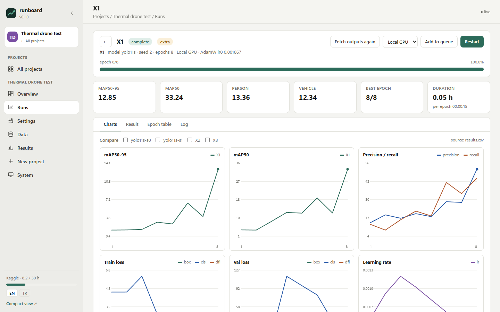
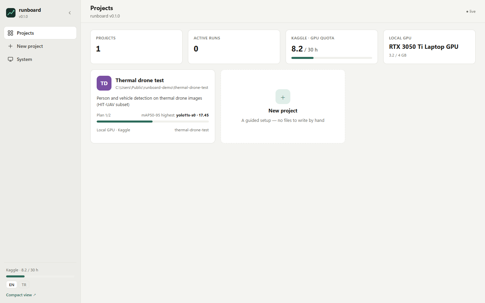
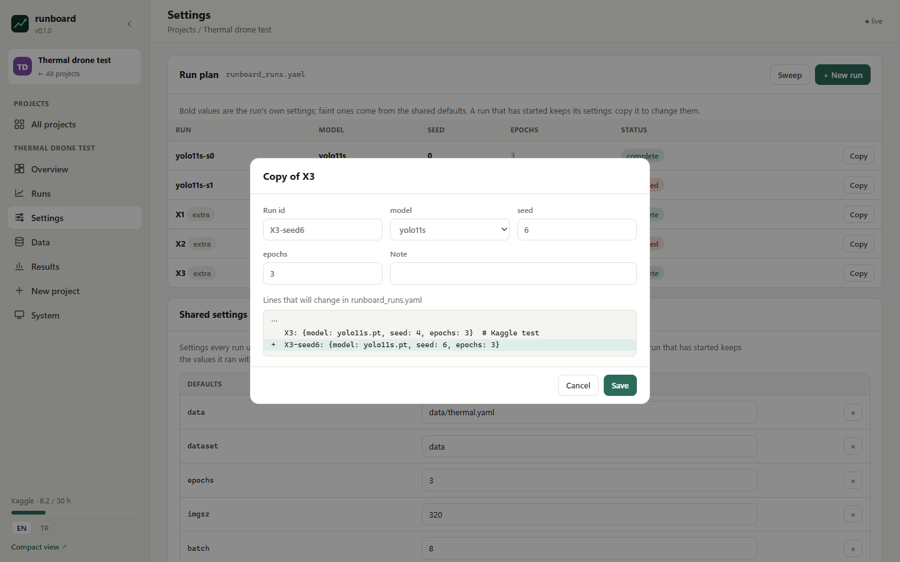

# runboard

**One self-hosted dashboard for all your ML training runs.** Launch a run on Kaggle or on your own GPU, watch it live
(epoch, batch, it/s, metrics, ETA — updated every second), and collect the results when it finishes, for every
project you work on.

[Türkçe](README.tr.md) · [](https://github.com/alperentoker/runboard-ml/actions/workflows/tests.yml)

<picture>
  <source media="(prefers-color-scheme: dark)" srcset="docs/images/run-dark.png">
  
</picture>

<table><tr>
<td width="50%">

<picture>
  <source media="(prefers-color-scheme: dark)" srcset="docs/images/home-dark.png">
  
</picture>

<sub>Projects home</sub>
</td>
<td width="50%">

<picture>
  <source media="(prefers-color-scheme: dark)" srcset="docs/images/plan-dark.png">
  
</picture>

<sub>Editing the plan: a preview of the exact lines that change</sub>
</td>
</tr></table>

- **Projects home** — every project is a card: live progress of its active run, plan completion, best score.
- **Live runs** — log streaming, second-by-second progress between log lines, metric and loss charts, run-to-run comparison.
- **Compute backends** — Kaggle Notebooks (private kernels, live logs, weekly GPU quota, dataset upload) and the local GPU (detached, survives dashboard restarts, can be cancelled). The backend interface is small; Colab is planned.
- **Pre-registration friendly** — lock the planned runs and shared settings, add clearly-marked extra runs, and record decisions (e.g. "winning architecture") with the numbers they were based on.
- **Plan editing** — edit, copy and add runs, shared settings or the whole runs file from the dashboard; only the changed lines are touched, every change is previewed as a diff, started runs keep their settings.
- **Sweeps and a queue** — one draft run per combination of values; a queue per backend that starts the next run when the backend is free and waits when the Kaggle quota would not cover it.
- **Results** — tables, curves and seed-variance summaries defined in the project manifest.
- **Tablet view** — `/mini` with picture-in-picture, installable on the home screen; a tablet pairs once with a QR code.
- **English / Türkçe** interface.

Secrets never leave your machine: the Kaggle token stays in `~/.kaggle`, paired devices and all state live in
`~/.runboard`, never inside a project repository.

## Install

```bash
git clone https://github.com/alperentoker/runboard-ml
cd runboard-ml
pip install -e .[kaggle]
runboard serve        # http://localhost:8000 — this computer only, no password
```

Then, in the dashboard:

1. **System → Connections → Kaggle** (only if you want cloud GPUs): the panel walks you through creating a token on
   kaggle.com and pasting it once. It is saved to `~/.kaggle/access_token` on this machine, tested, and never shown again.
2. **New project**: pick a folder, choose *YOLO training (no code)* or *My own training script*, choose where to run
   (this computer, Kaggle; Colab is planned), review, create. runboard writes `runboard.yaml`, `runboard_runs.yaml` and,
   for YOLO, a ready training script into the folder — it never changes your files.

A folder that already has a `runboard.yaml` can be added from the same wizard or with `runboard add PATH`.

## Tablet access

By default runboard listens only on this computer (`127.0.0.1`) and asks for nothing. To follow runs from a tablet on
the same Wi-Fi, turn on **System → Tablet access** (the dashboard restarts on all network interfaces), press
**Pair a device** and scan the QR code with the tablet, or open the address shown and type the 6-digit code. The code
works once and for two minutes. Paired devices are listed there and can be removed at any time.

A paired device can follow, start and stop runs. Entering the Kaggle token, adding projects, the folder browser and
startup settings stay on this computer. Outside your home network, use a VPN such as Tailscale and add its machine
name to `allowed_hosts` in `~/.runboard/config.yaml`. See [SECURITY.md](SECURITY.md).

## A project by hand

The wizard covers the common cases. Under the hood a project is any folder with a `runboard.yaml`. runboard does not own your code or configs; the manifest just tells it
where things are:

```yaml
name: My detector
runs:
  file: configs/runs.yaml          # your runs, in your own format: a mapping of run id -> fields
  section: runs
  defaults: train
  name: "{id}-{model|stem}-s{seed}"
backends:
  local:  {command: '"{python}" train.py --run {id}', output_dir: runs/local}
  kaggle: {files: {train.py: train.py, runs.yaml: configs/runs.yaml}, command: "python train.py --run {id}"}
results:
  report: "{out}/summary.json"
  metrics: {primary: map50_95}
```

See [docs/manifest.md](docs/manifest.md) for every option and [examples/yolo-quickstart](examples/yolo-quickstart) for a
runnable project (YOLO11n on coco8, a couple of minutes on a laptop GPU).

## Reporting progress

Print one line per event from your training script — or copy [`runboard/rb.py`](runboard/rb.py) (stdlib only) next to it:

```python
import rb
rb.ultralytics(model)            # Ultralytics: one line adds everything below
rb.start(epochs=100, batches=798)
rb.beat(epoch=3, batch=400, batches=798, its=4.9)
rb.epoch(3, epochs=100, secs=171, metrics={"map": 48.2}, best=48.2, eta=time.time() + 3600)
```

Each call prints `@@rb {json}`; your own log lines are untouched. Projects with existing plain-text logs can describe
them with regular expressions instead (`progress.patterns`).

## Run it permanently

*System → Start runboard when Windows starts* (Windows), or a systemd/launchd service running `runboard serve`.
To reach it from outside your home network, put it behind a private network such as Tailscale rather than exposing the port.

## Development

```bash
pip install -e .[dev]
pytest
```

MIT licensed.
