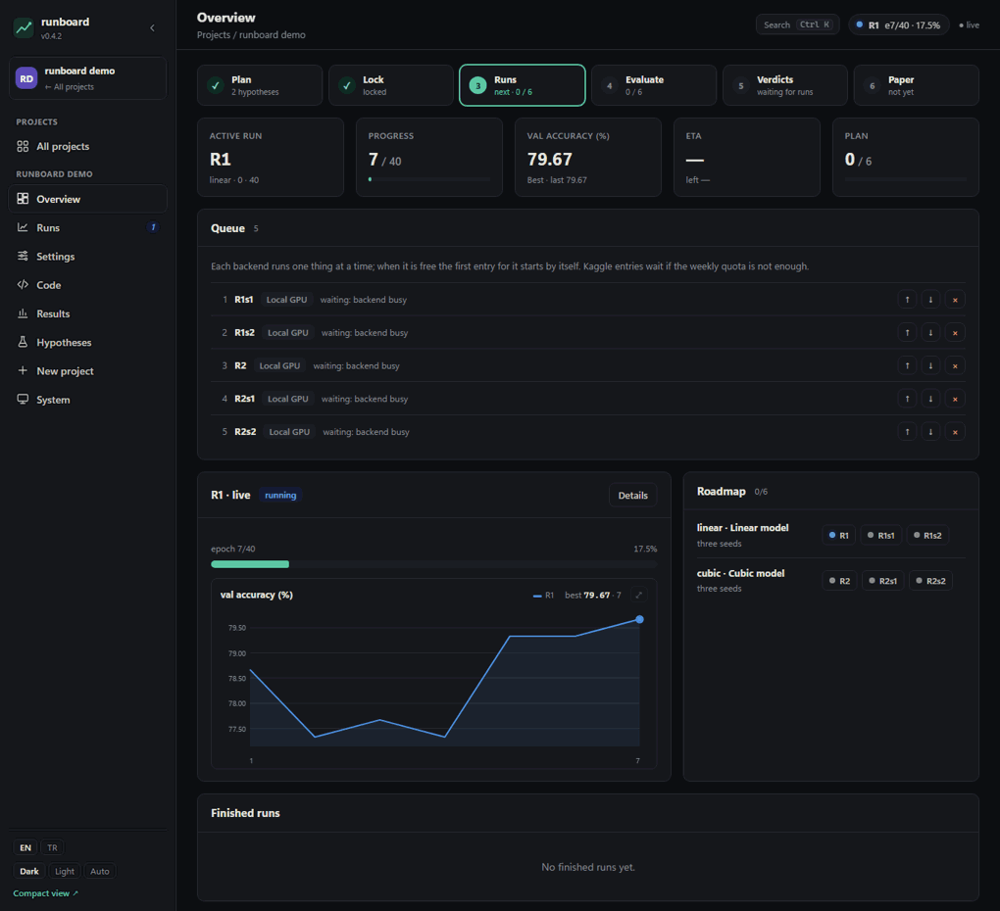
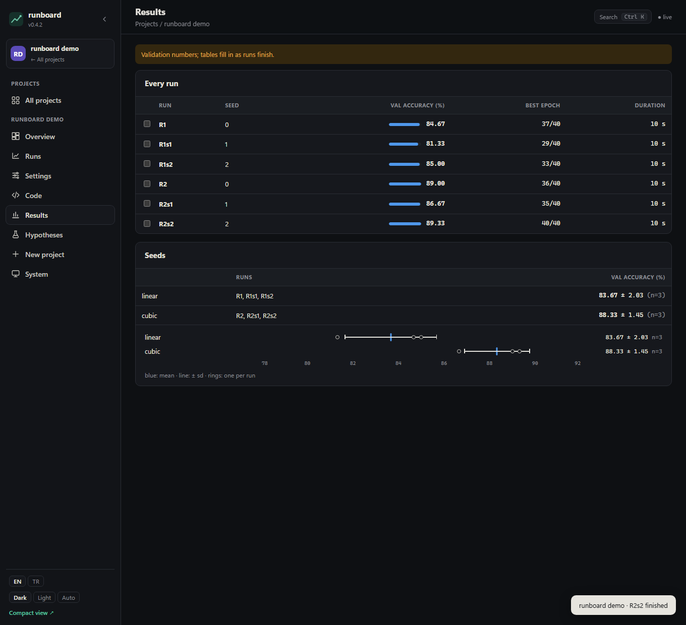

# runboard

**Eğitim koşuların için bir panel: istediğin yerde başlat, canlı izle, düzenli tut.**

runboard kendi bilgisayarında çalışır ve projelerinin eğitim koşularını yönetir. Bir koşuyu bu bilgisayarın
GPU'sunda, Kaggle'ın ücretsiz GPU'larında, SSH ile bağlandığın kiralık bir makinede ya da bir SLURM kümesinde tek
sayfadan başlatırsın. Her koşuyu saniye saniye izlersin (günlük, epoch, metrikler, kalan süre), sıradakileri kuyruğa
alırsın, karşılaştırırsın, planı ve kodu düzenlersin, sonuçları yan yana görürsün.

Her şey proje klasöründe okunabilir dosyalar olarak durur ve git'e girer: hesap yok, sunucu yok, gizli veritabanı yok.

[](https://github.com/alperentoker/runboard-ml/actions/workflows/tests.yml)
· [Belgeler](https://alperentoker.github.io/runboard-ml/tr/)
· [English](https://github.com/alperentoker/runboard-ml/blob/main/README.md)
· [Rehber (İngilizce)](https://github.com/alperentoker/runboard-ml/blob/main/docs/tutorial.md)
· [Başvuru](https://github.com/alperentoker/runboard-ml/blob/main/docs/manifest.md)
· [Değişiklikler](https://github.com/alperentoker/runboard-ml/blob/main/CHANGELOG.md)



## İçindekiler

- [Ne işe yarar](#ne-işe-yarar)
- [Beş dakikada dene](#beş-dakikada-dene)
- [Koşular nerede çalışır](#koşular-nerede-çalışır)
- [Özellikler](#özellikler)
- [Bir projede neler var](#bir-projede-neler-var)
- [Kendi eğitim betiğin](#kendi-eğitim-betiğin)
- [Ön kayıtlı deneyler (isteğe bağlı)](#ön-kayıtlı-deneyler-isteğe-bağlı)
- [Komut satırı](#komut-satırı)
- [Tablet ve güvenlik](#tablet-ve-güvenlik)
- [Sürekli çalıştırmak](#sürekli-çalıştırmak)
- [Geliştirme](#geliştirme)

## Ne işe yarar

Birkaç düzine model eğitmek çoğu zaman her makine için bir terminal, her Kaggle koşusu için bir not defteri,
klasörlere dağılmış günlükler ve elle tutulan bir sonuç tablosu demek. runboard bunları tek yerde toplar:

| İstediğin | runboard |
| :--- | :--- |
| bir koşu başlatmak | seçtiğin ortamda tek düğme; ya da kuyruğa al, ortam boşalınca kendisi başlar |
| nasıl gittiğini bilmek | canlı günlük, epoch ve batch, hız, metrikler, kayıp eğrileri ve kalan süre; her cihazdan |
| bulut kotasını boşa harcamamak | koşu gönderilmeden önce kısa bir duman testi (az veriyle tek epoch) ve sözdizimi denetimi |
| sırada ne koşacağını değiştirmek | koşuları düzenle, kopyala, ekle, sil, değer taramaları; kaydetmeden önce farkını gör |
| kodu düzeltmek | projenin dosyalarını panelde oku ve düzenle |
| nerede olduğunu görmek | sonuç tabloları, tohum özetleri, sınıf panelleri, koşu karşılaştırması, ne zaman ne koştuğunun zaman çizelgesi |



## Beş dakikada dene

```bash
pip install runboard-ml numpy
runboard demo        # ~/runboard-demo içine küçük bir demo proje kurar ve panele ekler
runboard             # paneli başlatır; http://localhost:8000 adresini aç
```

Demo GPU istemez, hiçbir şey indirmez: sentetik veride iki model (doğrusal ve kübik), her biri üç tohumla. Altı
koşuyu kuyruğa ekle (her biri yaklaşık on saniye), eğitilişlerini izle, sonra sonuçlara bak ve koşuları karşılaştır.
[Rehber](https://github.com/alperentoker/runboard-ml/blob/main/docs/tutorial.md) her ekranı adım adım gösterir.

> PyPI'daki paketin adı **runboard-ml**, çünkü `runboard` adı başka bir projeye ait; komut ve Python modülü `runboard`.
> İkisini aynı ortama kurma. Python 3.11 ya da daha yenisi gerekir; Kaggle istemcisi için `pip install "runboard-ml[kaggle]"`.

## Koşular nerede çalışır

| Ortam | Ne için | Nasıl |
| :--- | :--- | :--- |
| **Yerel** | bu bilgisayarın GPU'su (ya da CPU'su) | panel yeniden başlasa da süren ayrı bir süreç; durdurulabilir |
| **Kaggle** | ücretsiz bulut GPU'ları (haftada yaklaşık 30 saat) | özel betik çekirdekleri, canlı günlük, genel bakışta ve kuyrukta haftalık kota, yasak yol denetimiyle özel veri kümesi yükleme |
| **SSH** | kiralık bir GPU, laboratuvar sunucusu | kendi `ssh`'ın ve anahtarların (runboard şifre görmez); kod tar olarak gider, koşu karşı tarafta ayrı çalışır, günlük akar, çıktılar eve gelir |
| **SLURM** | üniversite kümesi | giriş düğümünde `sbatch` ile işler, `sacct` ile takip, `scancel` ile durdurma; kuyrukta istediğin kadar |

Bir proje birkaçını birden kullanabilir. Her koşu nerede çalıştığını ve neyle başladığını kaydeder: commit,
commit edilmemiş değişiklikler, koşuların, betiklerin ve verinin parmak izleri. SSH ve SLURM ortamları her
değişiklikte gerçek bir makineye karşı test edilir: bir kapsayıcıda sshd ve kayıt tutan tek düğümlü bir SLURM
kümesi (`tests/docker`).

## Özellikler

**Çalıştırma**
- Projeler arası tek kuyruk: her ortam boşalınca sıradakini başlatır; Kaggle girdileri haftalık kota yetmeyecekse
  bekler.
- Günlük satırları arasında bile canlı ilerleme, durduktan sonra devam etme, koşu sayfasından durdurma ve yeniden
  başlatma.
- Bir koşu bitince (skoruyla), hata verince ya da durdurulunca Windows bildirimi; hiçbir sayfa açık olmasa da
  gelir, tıklayınca koşuyu açar.
- Duman testi: gerçek koşu bulut kotası harcamadan önce az veriyle kısa bir epoch.

**İzleme**
- En iyi noktası işaretli metrik ve kayıp grafikleri, eğitim ve doğrulama kaybı birlikte, öğrenme oranı şeridi;
  büyük görünümde yakınlaştırma, kaydırma, yumuşatma, log ölçek ve CSV.
- Koşuları karşılaştırma: eğrilerini üst üste çiz ya da sonuç tablosunda işaretle, her sayıyı farkıyla yan yana gör.
- Genel bakış: çalışan koşu, kuyruk, planın ilerlemesi, ne zaman ne koştuğunun zaman çizelgesi ve Kaggle GPU haftası.

**Planlama**
- Yeni proje sihirbazı: bir YOLO veri kümesi ve modeller seç (eğitim betiğini runboard yazar) ya da kendi betiğini
  göster; bir koşu bir ayar takımı ya da komut satırı argümanlarıdır.
- Panelde plan düzenleme: koşuları düzenle, kopyala, ekle, sil, taramalar (her değer birleşimi için bir koşu), ortak
  ayarlar ve dosyanın tamamı; her değişiklik önce fark olarak gösterilir ve yedeklenir; başlamış koşular ayarlarını
  korur.

**Kod**
- Kod sayfası: projenin dosyalarını her yerden oku, bu bilgisayardan değiştir; kaydetmeden önce sözdizimi denetimi.
- YOLO veri kümeleri için şablonlar: split (tohumlu, videoları ya da sahneleri tek bölmede tutar), check (bozuk
  etiketler, bölmeler arası sızıntı, birbirine benzeyen görüntüler), convert (COCO / VOC'den YOLO'ya), subsets (iç içe
  veri miktarı listeleri), evaluate, speed. Bir formdan bir kez yazılır; sen değiştirmediğin sürece yeniden yazılır.

**Sonuçlar**
- `runboard.yaml`'dan sonuç tabloları ve tohum özetleri, sınıf başına küçük paneller, veri miktarı eğrileri.

**Her yerde**
- Hızlı arama (Ctrl+K): projeler, sayfalar, koşular; tablet görünümü (`/mini`) ve QR kodla eşleştirme; English ve
  Türkçe; koyu, açık ya da sistemin teması.

## Bir projede neler var

Proje, içinde `runboard.yaml` olan herhangi bir klasördür. runboard birkaç dosya ekler, seninkileri asla değiştirmez.

| Dosya | Ne tutar |
| :--- | :--- |
| `runboard.yaml` | koşular nasıl başlar (komutlar, ortamlar), ne raporlar, aşamalar ve tablolar, işler |
| koşu dosyası (`runs.yaml` ya da kendi dosyan) | koşular ve ortak ayarları, senin biçiminde |
| şablonlardan gelen betikler | split, check, subsets, evaluate, speed, convert: okuyup değiştirebileceğin sıradan Python |

Projenin parçası olmayan durum (koşu kayıtları, günlükler, eşleşmiş cihazlar) projede değil, `~/.runboard` içinde
durur.

## Kendi eğitim betiğin

Sihirbazdaki *Kendi eğitim kodum* hangi çerçeveyle yazılmış olursa olsun herhangi bir betiği koşu başına
argümanlarla çalıştırır. Canlı ilerleme için her olayda bir satır yazdır ya da `rb.py`'yi kullan (yalnızca standart
kütüphane; sihirbaz ve demo onu betiklerinin yanına kopyalar):

```python
import rb
rb.start(epochs=100)
rb.epoch(3, epochs=100, accuracy=0.91, val_accuracy=0.88, loss=0.31)   # her sayı kendi adıyla bir eğri olur
rb.report(score=88.4, best_epoch=37)                                   # sonuç tablosunun gösterdiği sonuç
rb.ultralytics(model)            # Ultralytics: tek satır yukarıdakilerin hepsini bildirir
```

Her koşuya çıktılarının nereye gideceği söylenir: `rb.out()` (ya da `RUNBOARD_OUT` değişkeni) runboard'un eve
getirdiği ve sonuçları okuduğu klasördür; yerelde, Kaggle'da, SSH'de ve SLURM'da aynı. `RUNBOARD_RUN` koşunun adıdır.
Betiğin oraya her epoch'a bir satır olan bir CSV yazıyorsa onu eğri dosyası olarak verebilirsin: her sayısal sütun bir
eğri olur. *Ön kayıtlı* işaretlenirse sihirbaz soruları, değerlendirme kümelerini ve hipotezleri de sorar; değerlendirme
betiğin her koşunun sonuçlarını `rb.resample_plan` ve `rb.write_samples` (ya da `rb.write_eval`) ile yazar, runboard
hipotezleri her projede olduğu gibi karara bağlar.

Elle kurulan bir proje kısa bir `runboard.yaml`'dır:

```yaml
version: 2
name: Benim dedektörüm
runs: {file: configs/runs.yaml, section: runs, defaults: train, name: "{id}"}
backends:
  local:  {command: '"{python}" train.py --run {id}', output_dir: runs/local}
  slurm:  {host: login.cluster.edu, sbatch: {partition: gpu, gres: "gpu:1"}, command: 'python train.py --run {id}'}
results:
  report: "{out}/summary.json"
  metrics: {primary: map50_95}
```

Bütün seçenekler [başvuru belgesinde](https://github.com/alperentoker/runboard-ml/blob/main/docs/manifest.md).

## Ön kayıtlı deneyler (isteğe bağlı)

Bir projenin beklentilerini sonuçlardan önce yazdığını göstermesi gerektiğinde (tez, makale, kurum içi bir karar)
projeye bir `plan.yaml` eklenebilir: sorular, makinenin kontrol edebileceği ölçütler olarak yazılmış hipotezler ve
koşuların nasıl değerlendirileceği.

```yaml
hypotheses:
  - id: H2
    text: Hava verisinin dörtte biri, hava uzmanının %90'ına ulaşır.
    criterion: "R7.aerial >= 0.9 * R5.aerial"
```

- **Kilit** (*Hipotezler → Planı kilitle*): `plan.lock.json` zamanı, commit'i ve parmak izlerini tutar; sonraki
  değişiklikler gerekçe ister ve `deviations.md`'ye yazılır.
- **Kararlar:** bir değerlendirme betiği her koşuyu ortak bootstrap turlarında ölçer; her ölçüt %95 aralığıyla
  *desteklendi*, *reddedildi* ya da *ayırt edilemedi* çıkar, orman grafiği ve histogramlarla gösterilir.
- **Dışa aktarma:** `paper/` içine Markdown ve LaTeX tablolar, yöntem taslağı, sapmalar ve bir rapor sayfası.

Sihirbazdaki *Önceden kayıtlı deney* bunu YOLO projeleri için kurar; demo da bunu kullanır. Ölçüt dili, değerlendirme
biçimi ve kilit [başvuru belgesinde](https://github.com/alperentoker/runboard-ml/blob/main/docs/manifest.md) ve
[tasarım notlarında](https://github.com/alperentoker/runboard-ml/blob/main/docs/design-v2.md) anlatılır. `plan.yaml`
olmayan projelerde bu sayfalar görünmez.

## Komut satırı

| Komut | Ne yapar |
| :--- | :--- |
| `runboard` / `runboard serve` | paneli (ve bekçisini) başlatır |
| `runboard stop` | ikisini durdurur |
| `runboard demo [klasör]` | beş dakikalık demo projeyi kurar |
| `runboard add YOL` / `remove YOL` / `list` | paneldeki projeleri yönetir |
| `runboard template AD [klasör] --set anahtar=değer` | bir şablondan betik yazar |
| `runboard lock` / `verdicts` / `export [klasör]` | ön kayıtlı projeler: planı kilitler, kararları yazdırır, `paper/` yazar |
| `runboard migrate [klasör]` | eski bir projenin kararlarını ve kilidini `plan.yaml`'a taşır |

## Tablet ve güvenlik

runboard varsayılan olarak yalnızca bu bilgisayarı dinler (`127.0.0.1`) ve hiçbir şey sormaz. Aynı Wi-Fi'daki bir
tabletten izlemek için **Sistem → Tablet erişimi**'ni aç, **Cihaz eşleştir**'e bas ve QR kodu okut ya da 6 haneli kodu
yaz (iki dakika geçerli, tek kullanımlık). Eşleşmiş cihazlar koşuları izleyebilir, başlatıp durdurabilir ve koşuları
düzenleyebilir; anahtarlar, yeni projeler, kod, proje dosyası ve klasör gezgini bu bilgisayarda kalır, komuta giren
her değer önce denetlenir. Kaggle anahtarı `~/.kaggle` içinde durur. Bağlantı düz HTTP'dir, şifreli değildir: tablet erişimini yalnızca güvendiğin bir ağda aç; onun dışında Tailscale gibi bir VPN
kullan.
Ayrıntılar [SECURITY.md](https://github.com/alperentoker/runboard-ml/blob/main/SECURITY.md)'de.

**Tarayıcılar.** Panel 2023 ve sonrası bir tarayıcı ister: Chrome veya Edge 111, Safari 16.2 (iOS 16.2), Firefox 121.
Eski bir tablet, etkin koşuların tek ekranlık görünümü `/mini`'yi açabilir; o 2020 ve sonrası bir tarayıcıyla da çalışır
(Chrome 80, Safari 13.1, Firefox 74).

## Sürekli çalıştırmak

*Sistem → Bu bilgisayarda oturum açınca runboard'u başlat* bunu her sistemin kendi yoluyla kurar: Windows'ta bir
başlangıç betiği, Linux'ta bir systemd kullanıcı servisi (`~/.config/systemd/user/runboard.service`), macOS'ta bir
launchd ajanı (`~/Library/LaunchAgents/io.github.runboard.plist`). Bir sonraki oturum açışta etkin olur; Linux'ta
oturum açmadan açılışta başlaması için bir kez `loginctl enable-linger` çalıştır. `runboard serve` panel yanıt
vermezse onu yeniden başlatan bir bekçi çalıştırır (systemd ve launchd altında bunu servis yöneticisi yapar) ve
her başlatma, durma ve hatayı `~/.runboard/server.log`'a yazar.

Yerel koşular ve işler (doğrulama, testler, bir değerlendirme …) kendi başlarına çalışır: panel yeniden başlasa, çökse
ya da `runboard stop` ile durdurulsa da sürerler ve sonraki panel onları kaldıkları yerde, bütün kayıtlarıyla gösterir.

## Geliştirme

```bash
git clone https://github.com/alperentoker/runboard-ml
cd runboard-ml
pip install -e .[dev]
pytest                # 200'den fazla test; Chrome ya da Edge kuruluysa gerçek, başsız bir tarayıcıyla
```

Planlar: [ROADMAP.md](https://github.com/alperentoker/runboard-ml/blob/main/ROADMAP.md) · sürümler:
[RELEASING.md](https://github.com/alperentoker/runboard-ml/blob/main/RELEASING.md) · MIT lisanslı.
