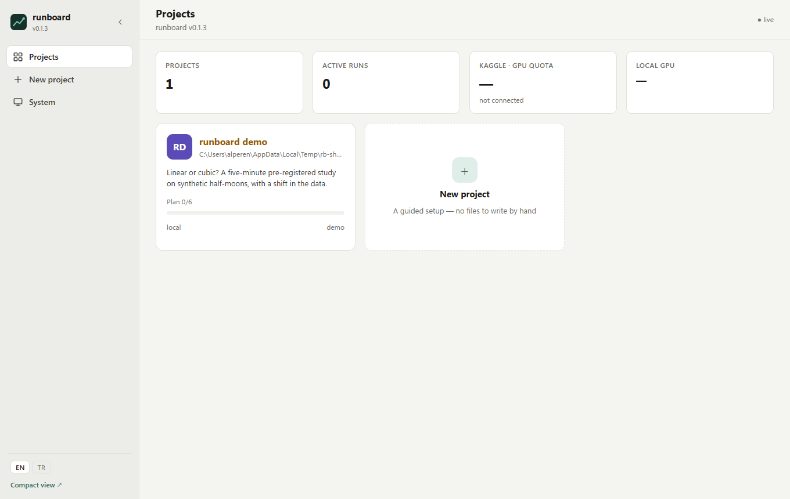
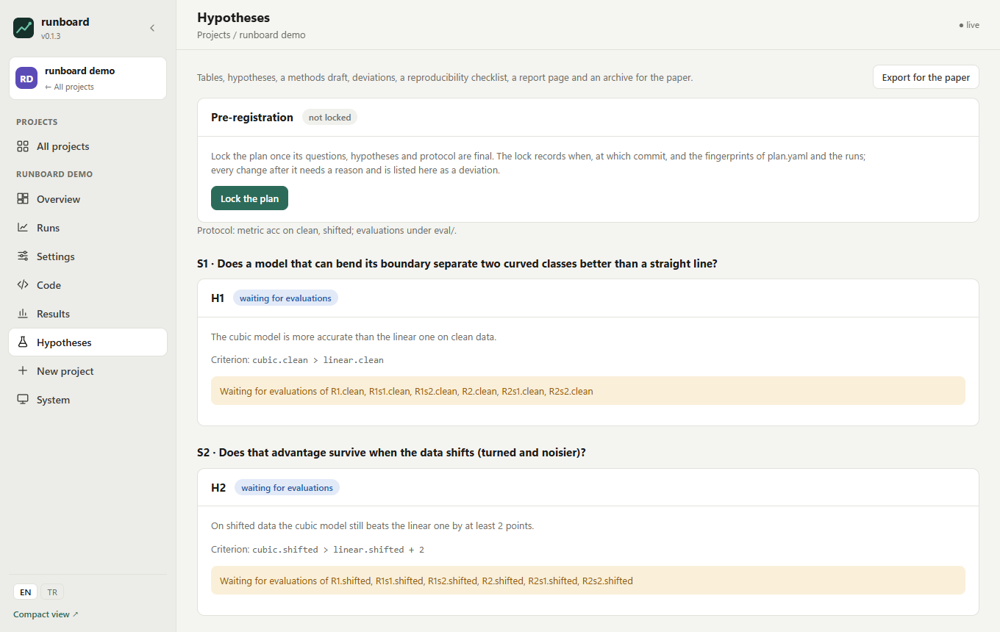
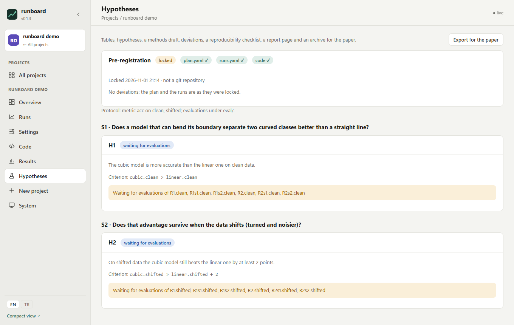
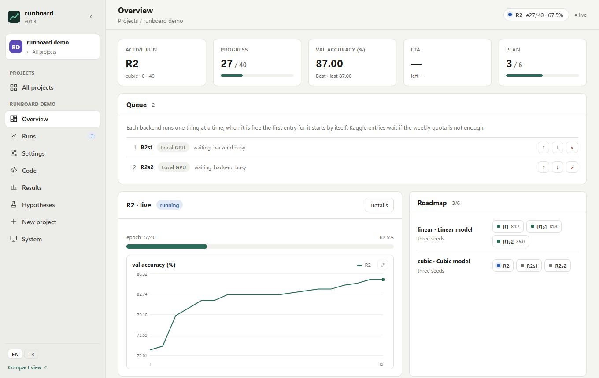
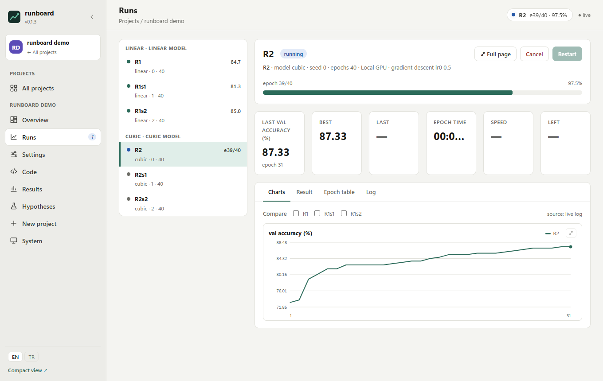
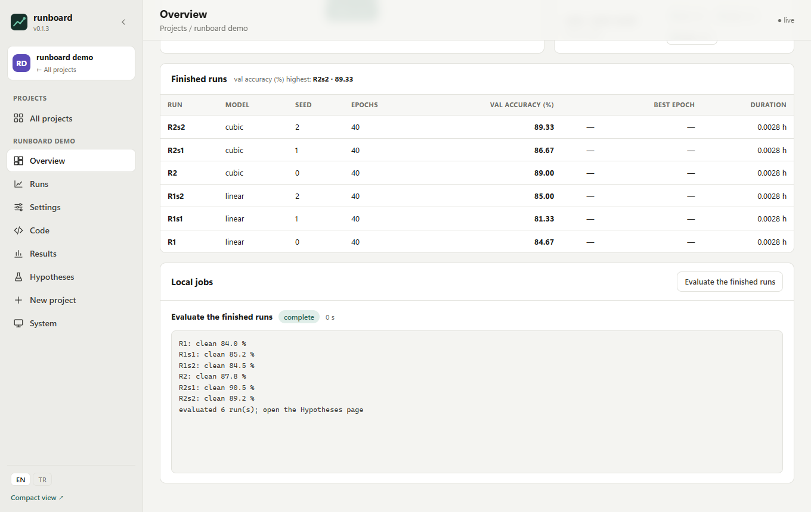
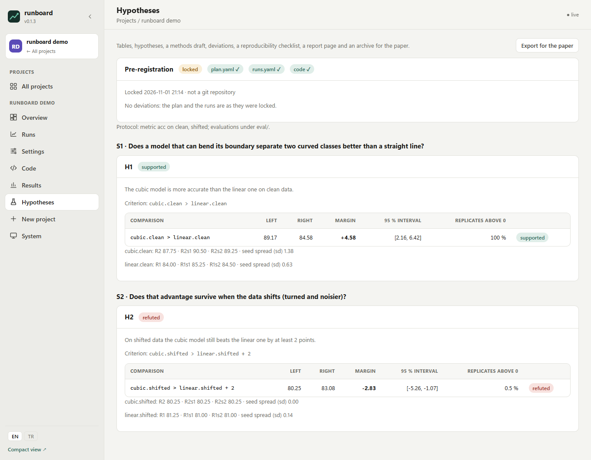
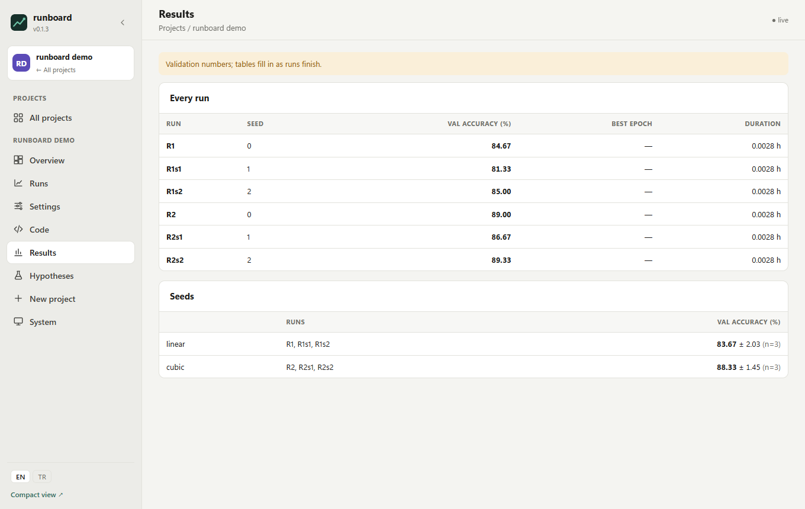
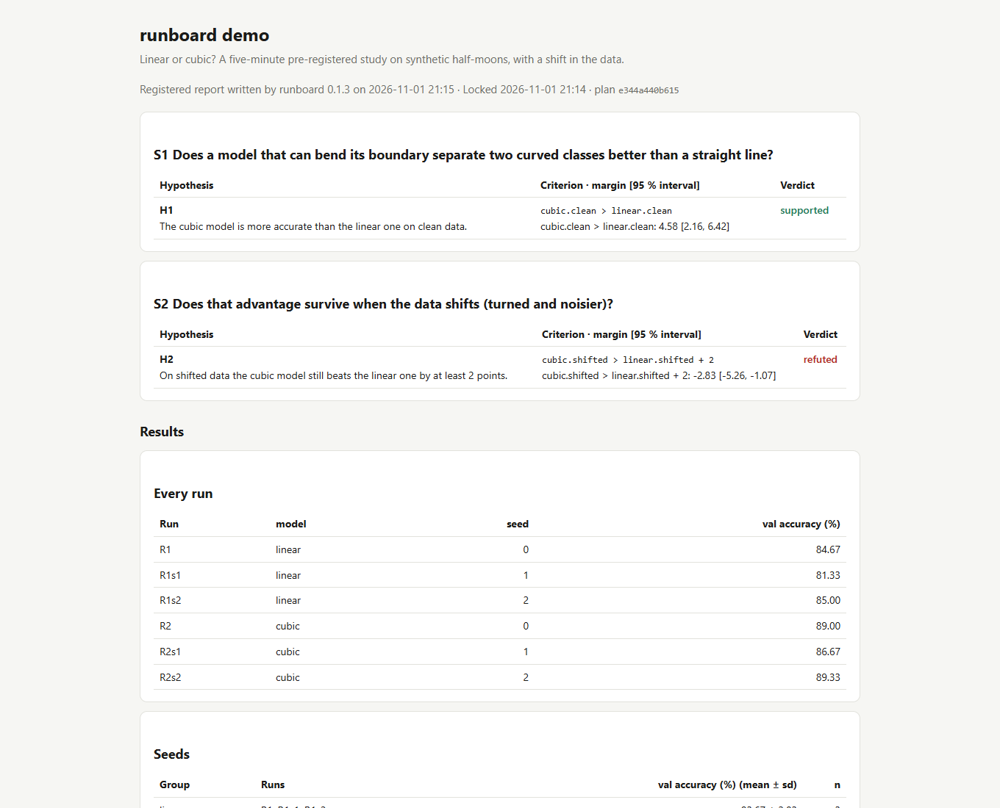

# Five minutes with runboard: a pre-registered study from start to verdict

This walkthrough runs a complete, small study on your own computer: you write nothing, train six tiny models, and
watch runboard decide two hypotheses with confidence intervals. It needs Python 3.11+, runboard and numpy. No GPU,
no account, no download.

**The study.** Two classes shaped like interleaving half-moons. A *linear* model can only draw a straight boundary;
a *cubic* one can bend. Each is trained with three seeds (R1, R1s1, R1s2 and R2, R2s1, R2s2). Two questions:

- **S1** Does the bendable model separate the classes better? Hypothesis **H1**: `cubic.clean > linear.clean`
- **S2** Does that advantage survive when the data shifts (turned by 30° and noisier)? Hypothesis **H2**:
  `cubic.shifted > linear.shifted + 2` (still at least 2 points ahead)

`cubic` and `linear` are seed groups: the mean of their three runs. `clean` and `shifted` are the two evaluation sets.

## 1. Install and set up the demo

```bash
pip install "runboard @ git+https://github.com/alperentoker/runboard-ml" numpy
runboard demo
runboard
```

`runboard demo` copies the study into `~/runboard-demo` (or the folder you name) and adds it to the dashboard;
`runboard` starts the dashboard. Open <http://localhost:8000>.



The folder holds everything the study is, as ordinary files you can read:

| File | What it is |
| :--- | :--- |
| `plan.yaml` | the science: questions, hypotheses with their criteria, the evaluation protocol, the seed groups |
| `runs.yaml` | the six runs and their shared settings |
| `runboard.yaml` | how runs start (a local command), what they report, the phases, tables and the evaluation job |
| `train.py`, `evaluate.py` | training and evaluation, with `rb.py` reporting progress to the dashboard |

## 2. Read the plan, then lock it

Open the project and go to **Hypotheses**. Each hypothesis is waiting for evaluations: nothing has run yet.



Pre-registration means deciding what counts as success *before* seeing results. Click **Lock the plan**. runboard
writes `plan.lock.json`: the time, the git commit if the folder is a repository, and fingerprints of the plan and the
runs. From now on, changing either needs a written reason and is listed as a deviation.



## 3. Run the six trainings

Go to **Runs** and click **Queue the 6 not started** at the top of the run list (a single run: open it and click
**Start** or **Add to queue**). Runs start one after the other on this computer, about ten seconds each. The **Overview** shows the
active run, the queue and the accuracy curve as it grows.



Every run page has the live log, the curves, the settings it started with and where it started from (the commit and
the fingerprints of the plan, runs and data).



## 4. Evaluate

When the six are finished, the **Overview** lists them. Under **Local jobs**, click **Evaluate the finished runs**.
`evaluate.py` scores every run on both sets, item by item, and writes `eval/<run>/<set>.json`. Each set has one
resampling plan (`eval/resample-<set>.json`) shared by every run, so the 200 bootstrap replicates compare all runs on
the same items.



## 5. Read the verdicts

Back on **Hypotheses**, each comparison now has its value on the whole set, the margin, the 95 % interval of the
margin over the bootstrap replicates, and the share of replicates above zero.



- **H1 supported**: the cubic model is about 4.6 points ahead on clean data and the whole interval is above zero.
- **H2 refuted**: on shifted data it is *behind* the "2 points ahead" mark, and the whole interval is below zero.

A third verdict, *indistinguishable*, appears when the interval contains zero. The seed lines under each comparison
show how much the three runs of a group disagree.

The **Results** page has the tables of `runboard.yaml`: every run, and the seed groups as mean ± sd.



## 6. Export for the paper

On **Hypotheses**, click **Export for the paper**. runboard writes `paper/` into the project:

| File | For |
| :--- | :--- |
| `tables.md`, `tables.tex` | the results tables (LaTeX with booktabs) |
| `hypotheses.md`, `hypotheses.tex` | each hypothesis with its margin, interval and verdict |
| `methods.md` | a draft of the methods section: the lock, the design, the settings, the decision rule |
| `deviations.md` | the deviations section (here: none) |
| `checklist.md` | a reproducibility checklist filled from the files |
| `report.html` | one page with all of it, for a supervisor or a reviewer |
| `archive.zip` | plan, lock, runs, scripts and evaluation files, ready for Zenodo (no data, no weights) |



## 7. Try a deviation

Change something after the lock to see what happens: on **Settings → Research plan**, edit H2's criterion to `+ 1`
instead of `+ 2`. runboard asks for a reason; give one, save, and the change appears on **Hypotheses** as a
deviation, with its diff in `deviations.md`. Exported again, the methods draft and the report say so. A change made
in a text editor behind runboard's back is caught too: the lock card turns red until you record it.

## Where to go next

- Your own study: **New project → Pre-registered study (YOLO)** walks through questions, designs (specialists, a
  data-size curve, architectures, ablations, seeds), the protocol and the hypotheses, and writes the evaluation
  scripts. Your own script works too: see [the manifest reference](manifest.md).
- Where runs go: your GPU, Kaggle, a machine over SSH, or a SLURM cluster ([backends](manifest.md#backends)).
- How the verdicts are computed: [docs/design-v2.md](design-v2.md).
